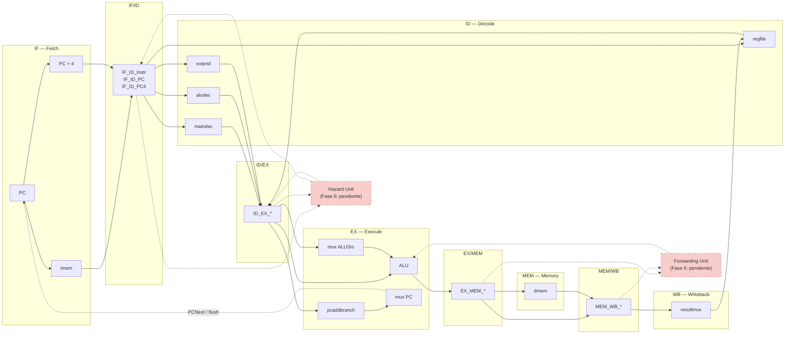

# Diagrama del datapath single-issue (estado actual del proyecto)

> **Actualizado con la Fase 4 completada.** El diagrama definitivo en formato Draw.io está en
> `doc/diagrama_datapath_single_issue.drawio`. Este documento mantiene la versión Mermaid/ASCII
> como respaldo para el informe.

## Respuesta corta

**Sí, el diagrama ya se puede hacer completo** para las cinco etapas: el pipeline single-issue
está implementado hasta la Fase 4 (`datapath_pipeline.v` + `top_pipeline.v`), con el registro
`MEM/WB` y el writeback real desde `MEM_WB_*`.

Lo único que sigue pendiente es la **Fase 6**: forwarding, detección de load-use y los stalls
reales. Esos bloques se dibujan punteados como “pendiente”.

No uses `datapath.v` para este diagrama: ese archivo es el **single-cycle de referencia** que se
restauró. El pipeline está en `src files/datapath_pipeline.v`.

---

## Diagrama de etapas (estado actual, Fase 4)



**Leyenda:**

- Líneas sólidas: implementado y verificado (Fases 1–4).
- Líneas punteadas hacia Hazard Unit y Forwarding Unit: Fase 6 pendiente.
- Línea punteada `PCNext / flush`: realimentación de control de EX a IF. El flush de branch ya
  está implementado desde la Fase 3.

---

## Componentes por etapa

| Etapa | Componentes en el proyecto | Archivo |
|-------|----------------------------|---------|
| **IF** | `PC`, `pcadd4`, `imem` | `datapath_pipeline.v`, `top_pipeline.v` |
| **IF/ID** | Registro de instrucción, PC y PC+4 | `ifid.v` |
| **ID** | `maindec`, `aludec`, `regfile`, `extend` | `datapath_pipeline.v` |
| **ID/EX** | Registro de operandos, inmediato, PC, PC+4, rs1/rs2/rd y controles | `idex.v` + `flopenrc.v` |
| **EX** | Mux `ALUSrc`, ALU, `pcaddbranch`, mux de PC | `datapath_pipeline.v` |
| **EX/MEM** | Registro de ALUResult, Zero, WriteData, rd, PC4, PCTarget y controles | `exmem.v` |
| **MEM** | `dmem` (lectura/escritura) | `top_pipeline.v` |
| **MEM/WB** | Registro de ReadData, ALUResult, PC4, rd, RegWrite y ResultSrc | `memwb.v` |
| **WB** | `resultmux` y escritura del `regfile` con `MEM_WB_*` | `datapath_pipeline.v` |

---

## Qué falta para que el diagrama sea el definitivo

| Elemento | Estado | Fase |
|----------|--------|------|
| Registro `MEM/WB` | ✅ Implementado | Fase 4 |
| Writeback desde `MEM_WB_*` | ✅ Implementado | Fase 4 |
| Muxes de forwarding EX/MEM → EX | ❌ Falta | Fase 6 |
| Muxes de forwarding MEM/WB → EX | ❌ Falta | Fase 6 |
| Unidad de detección de load-use | ❌ Falta | Fase 6 |
| `stall_IF_ID` / `stall_ID_EX` reales | ❌ Están a `0` | Fase 6 |
| Flush de branch/jal | ✅ Implementado | Fase 3 |

---

## Versión ASCII (para pegar en el informe si no se renderiza Mermaid)

```text
        ┌──────────────┐   ┌──────────┐   ┌─────────────────────┐   ┌──────────┐
        │ IF / Fetch   │   │  IF/ID   │   │ ID / Decode         │   │  ID/EX   │
        │ PC, imem,    │──▶│ Instr    │──▶│ maindec, aludec,    │──▶│ operandos│
        │ PC+4         │   │ PC, PC+4 │   │ regfile, extend     │   │ controles│
        └──────────────┘   └──────────┘   └─────────────────────┘   └────┬─────┘
                ▲                                                        │
                │ PCNext / flush                                         ▼
        ┌───────┴──────┐   ┌──────────┐   ┌──────────┐   ┌──────────┐   ┌──────────┐
        │ EX / Execute │   │ EX/MEM   │   │ MEM      │   │ MEM/WB   │   │ WB       │
        │ mux ALUSrc,  │──▶│ ALUResult│──▶│ dmem     │──▶│ ReadData │──▶│ resultmux│
        │ ALU, branch  │   │ controles│   │          │   │ ALU/PC4  │   │ regfile  │
        └──────────────┘   └──────────┘   └──────────┘   └──────────┘   └──────────┘
```

---

## Recomendación

Para el informe:

1. Usa el archivo **`doc/diagrama_datapath_single_issue.drawio`** para la versión gráfica.
2. Si necesitas pegar texto, usa el diagrama Mermaid o el ASCII de este documento.
3. Aclara en el informe que:
   - **MEM/WB y el writeback ya están implementados** (Fase 4).
   - **Forwarding y load-use están pendientes** (Fase 6), por eso aparecen punteados.
   - El flush de branch sí está implementado (Fase 3).
